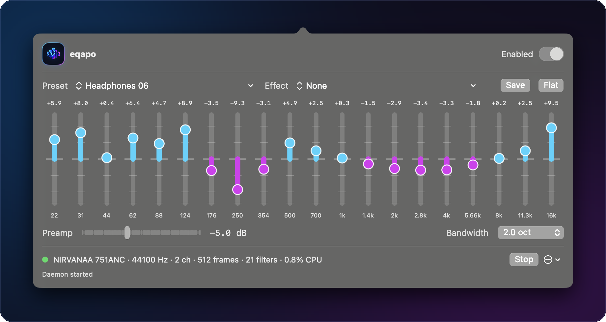

<p align="center">
  
</p>

<h1 align="center">eqapo</h1>

<p align="center">Audio equalizer for macOS, Windows, and Linux.</p>

<p align="center">
  <a href="https://github.com/PDGamerSG/eqapo/releases/latest"><strong>Download</strong></a> ·
  <a href="#install">Install</a> ·
  <a href="#build-from-source">Build from source</a>
</p>

<p align="center">
  
</p>

## What you get

- **macOS** — Live system-wide EQ with a 20-band menu bar app.
- **Windows and Linux** — A command-line tool for equalizing 32-bit float WAV files offline.
- **Every platform** — Built-in EQ and delay presets, custom filters, and Equalizer APO-style configuration.

## Install

| Platform | Download | Installation |
| --- | --- | --- |
| macOS 14.2+ (Apple silicon) | [DMG](https://github.com/PDGamerSG/eqapo/releases/download/v0.1.5/eqapo-0.1.5-macos-arm64.dmg) | Drag eqapo into Applications, open it, and allow System Audio Recording when prompted. |
| Windows (x64) | [EXE](https://github.com/PDGamerSG/eqapo/releases/download/v0.1.5/eqapo-0.1.5-windows-x64-setup.exe) | Run the installer. Select its PATH option to use `eqapo` in a new terminal. |
| Debian / Ubuntu (x64) | [DEB](https://github.com/PDGamerSG/eqapo/releases/download/v0.1.5/eqapo_0.1.5_amd64.deb) | Run `sudo apt install ./eqapo_0.1.5_amd64.deb` in the download folder. |

For offline processing, pick a preset and run it on a file.

```sh
eqapo preset apply rock
eqapo process input.wav output.wav
```

## Build from source

Use CMake 3.25+ and a C++20 compiler. On macOS, install the Xcode Command Line Tools for the Swift app.

```sh
cmake -S . -B build
cmake --build build
ctest --test-dir build --output-on-failure
```

On macOS, run `./scripts/package_dmg.sh` after building to create the app disk image.

## License

GPL-2.0-or-later. Inspired by Equalizer APO and PC Equalizer Free. [License](./COPYING) · [Preset credits](./presets/NOTICE.md)
